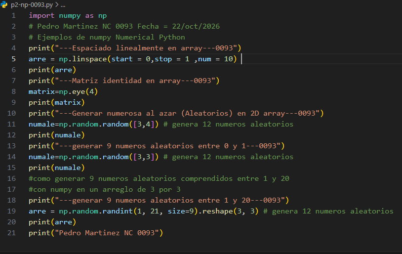
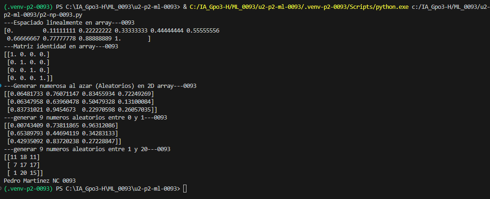

 ## Parametros de np.linspace
 - **`start = 0`**: valor inicial.
 - **`stop = 1`**: valor final.
 - **`num = 5`**: cantidad de números que se generan.

 ## Concepto np.linspace
 `np.linspace()` genera una secuencia de números igualmente espaciados dentro de un intervalo.

## El codigo

## Resultado
